<p align="center">
  
</p>

<h1 align="center">DCSMyWay</h1>

<p align="center">
  Pick points on the DCS World map and let DCSMyWay type them into your aircraft for you.
</p>

<p align="center">
  <a href="https://github.com/paladin2005/DCSMyWay/releases"></a>
  
  
</p>

---

> **Standing on the shoulders of giants.** DCSMyWay is inspired by [**DCS TheWay**](https://github.com/aronCiucu/DCSTheWay) by [**aronCiucu**](https://github.com/aronCiucu), a fantastic tool that showed how easy waypoint entry in DCS could be. The button sequences of every aircraft were ported from TheWay's own code and checked against it, so a big thank you to its author and contributors. DCSMyWay takes the same idea in a new direction: a native app that installs itself, reads your cockpit displays while it types, and goes deeper on aircraft like the Apache.

## Contents

- [Why DCSMyWay](#why-dcsmyway)
- [Supported aircraft](#supported-aircraft)
- [Download and first run](#download-and-first-run)
- [Guide](#guide)
  - [The main window](#the-main-window)
  - [Adding waypoints](#adding-waypoints)
  - [Transferring to the aircraft](#transferring-to-the-aircraft)
  - [Adding more waypoints later](#adding-more-waypoints-later)
  - [Overwrite or add after the active steerpoint](#overwrite-or-add-after-the-active-steerpoint)
  - [AH-64D Apache: route, targets and threats](#ah-64d-apache-route-targets-and-threats)
  - [Ka-50: waypoints and NAV targets](#ka-50-waypoints-and-nav-targets)
  - [Keyboard shortcuts](#keyboard-shortcuts)
  - [Settings](#settings)
- [Aircraft notes](#aircraft-notes)
- [Troubleshooting](#troubleshooting)
- [Uninstall](#uninstall)
- [Building from source](#building-from-source)

## Why DCSMyWay

| | |
|---|---|
| **One file, nothing to install** | Download `DCSMyWay.exe` and run it. No installer, no .NET or Windows App SDK runtime to install. |
| **Installs its own DCS scripts** | On every start it copies its scripts into `Saved Games\DCS`, adds its line to `Export.lua` (with a backup, leaving the lines of SimShaker, WinWing, TelemFFB and others exactly as they were) and keeps everything up to date when you get a new version. No files to copy by hand. |
| **Never types blind** | On the F/A-18C, A-10C, AH-64D, Ka-50 and Mirage F1EE every step is checked against the cockpit displays before the next one, and every waypoint is read back after it is entered. If something doesn't respond, the transfer stops and tells you exactly what happened instead of carrying on with the wrong page. |
| **Knows what is already in the jet** | Each waypoint gets a checkmark the moment it is confirmed in the cockpit. Add new points later and only those are sent, right after the last one. A cancelled or failed transfer keeps the checkmarks of the points that made it. |
| **You choose where they go** | It reads the active steerpoint from the cockpit and starts there, or you can **overwrite from** it or **add after** it with one click. |
| **A real route on the Apache** | Points are entered as exact MGRS, added to the TSD route (not just stored as points), and targets can carry a **threat type** so the TSD draws its engagement ring. |
| **Crosshair inside DCS** | The crosshair and the accept button are drawn by DCS itself, centered on your main view (multi-monitor and WinWing setups included). |
| **Your route on the F10 map** | Waypoints are drawn on the F10 map as you add them, targets in red, Apache threats with their engagement ring. |
| **Global shortcuts** | Show the crosshair, add, delete, transfer or clear without leaving DCS. Joystick buttons mapped to keys work too, and DCS doesn't receive the keys you assign. |
| **Native and light** | A small native Windows app (WinUI 3) that stays on top of DCS without stealing focus, in light or dark theme. |
| **Plays well with others** | Uses its own ports, so it can run side by side with TheWay. Works as a multiplayer client too. |

## Supported aircraft

| Aircraft | Points | Highlights |
|---|---|---|
| **F-16C Viper** (and the D, Barak and Sufa variants) | Steerpoints | Starts at the active steerpoint read from the DED |
| **F/A-18C Hornet** | Waypoints 1–59 | Every AMPCD page and UFC prompt checked, precise coordinates, each waypoint read back |
| **A-10C / A-10C II** | Mission waypoints 1–50 | Names included, each field read back, waypoints added to the active flight plan |
| **AH-64D Apache** (pilot and CPG) | Waypoints W01–W50 and targets | Exact MGRS, route on the TSD, targets with threat types and rings |
| **Ka-50 / Ka-50 III** | PVI-800 waypoints 1–6 and NAV targets 1–9 | Every digit checked as typed, each point read back |
| **Mirage F1EE** | INS waypoints 1–9 | Every digit, hemisphere and INSER checked on the PCN |

Not supported yet: AV-8B, F-15E, M-2000C, OH-58D and the mods. If you fly one of those, keep using TheWay for now; both apps can run at the same time.

## Download and first run

1. Download `DCSMyWay.exe` from the [Releases page](https://github.com/paladin2005/DCSMyWay/releases).
2. Put it anywhere you like (your desktop is fine) and double-click it.
   - The exe isn't signed yet, so Windows SmartScreen may say *"Windows protected your PC"*. Click **More info** and then **Run anyway**.
   - The first start takes a second longer while it unpacks itself.
3. DCSMyWay finds your DCS folder in `Saved Games` and installs its scripts. A green message tells you what it did:
   - **Restart DCS** if it was running, so it loads the new scripts.
4. Start a mission. When the aircraft chip appears at the top of the window, you're connected.

**Requirements:** Windows 10 version 2004 or later, or Windows 11, 64-bit, and DCS World (Steam or standalone).

## Guide

### The main window

<p align="center">
  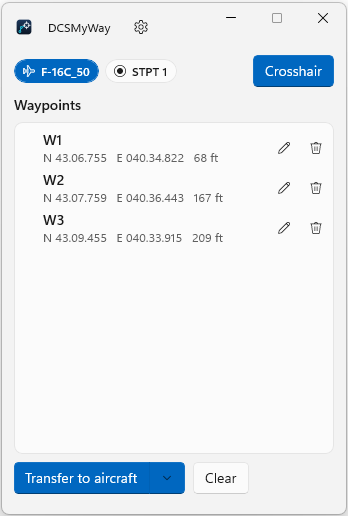
</p>

- **Aircraft chip** (blue): the aircraft you're flying. It appears as soon as DCS is connected.
- **Steerpoint chip**: the active steerpoint (STPT, WYPT or WPT) read live from the cockpit. Transfers start here.
- **Crosshair**: shows or hides the crosshair inside DCS.
- **Waypoints**: your list. The pencil renames a waypoint, the bin deletes it.
- **Transfer to aircraft**: enters the waypoints into the cockpit. The arrow opens more options.
- **Clear**: empties the list.

### Adding waypoints

Press **Crosshair** (or its shortcut). A green crosshair and a check button appear in the middle of the DCS screen. The F10 map is the easiest place to use it:

1. Move the map so the crosshair sits on the point you want.
2. Click the green check. The waypoint appears in the list (W1, W2, …) and on the F10 map, joined to the previous one.

<p align="center">
  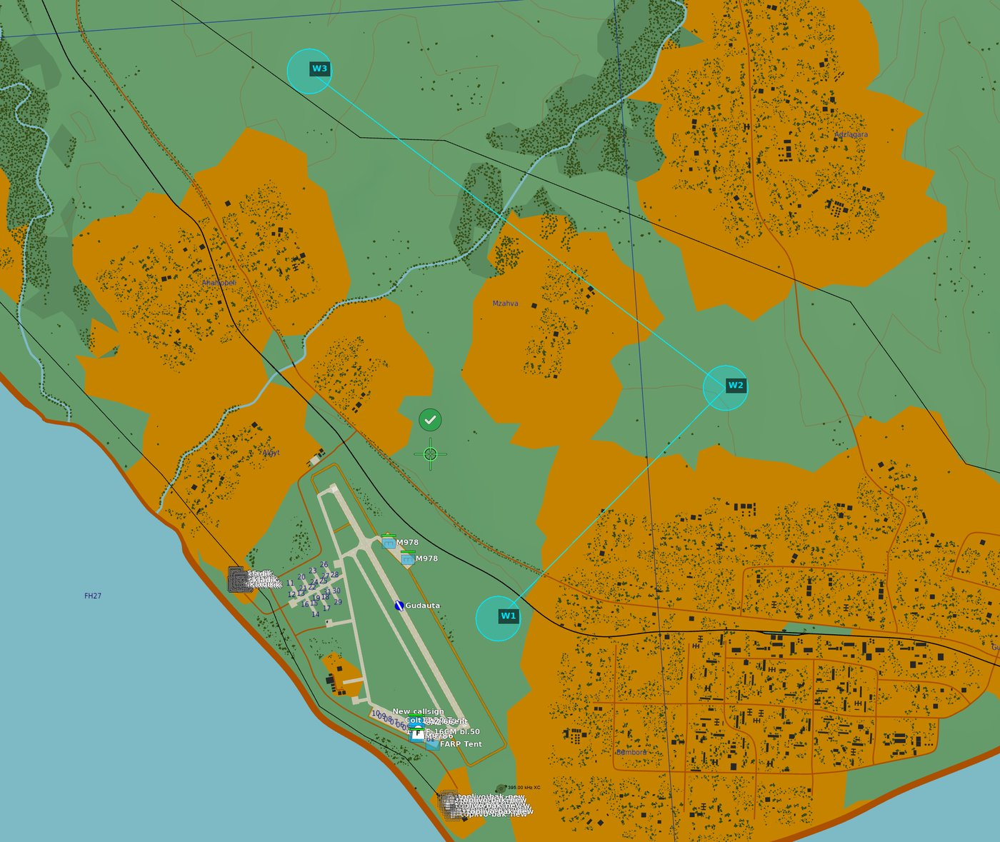
</p>

Elevation is taken from the terrain under the crosshair. To rename a waypoint, use the pencil. Names follow the A-10 CDU rules (up to 12 letters, digits or periods, starting with a letter), so they work in every aircraft.

### Transferring to the aircraft

1. Make sure the active steerpoint shows in the app (each aircraft needs its display on a certain page; the app tells you if it can't read it).
2. Click **Transfer to aircraft** and keep your hands off the cockpit controls until it finishes. The crosshair hides by itself.
3. Each waypoint gets a green checkmark as soon as it's confirmed in the cockpit.

<p align="center">
  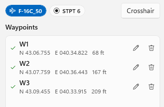
</p>

While a transfer runs, the button becomes **Cancel transfer**. If you cancel, or something in the cockpit doesn't respond, the waypoints that made it keep their checkmark.

### Adding more waypoints later

Add new points whenever you like. Only the ones without a checkmark are sent, right after the last waypoint you entered, so you can build your route bit by bit.

<p align="center">
  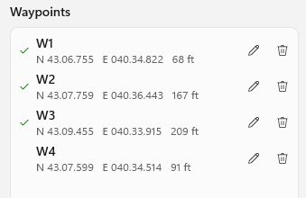
</p>

If every waypoint already has a checkmark, DCSMyWay asks before entering them all again:

<p align="center">
  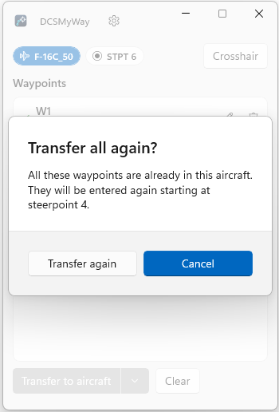
</p>

The checkmarks belong to that aircraft: after a respawn, or in a different aircraft, everything is sent again.

### Overwrite or add after the active steerpoint

The arrow next to **Transfer to aircraft** lets you decide where the waypoints go for that transfer:

<p align="center">
  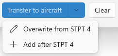
</p>

- **Overwrite from STPT 4**: enters your waypoints starting at the active steerpoint, replacing what was there.
- **Add after STPT 4**: keeps the active steerpoint and enters your waypoints right after it.

Both send the waypoints without a checkmark, or all of them if every one is already checked, without asking.

### AH-64D Apache: route, targets and threats

The Apache gets the full treatment:

- **Waypoints become a route.** Each waypoint is entered as a point and added to the end of the current route on the TSD, so you can fly it straight away. Points already in the route aren't added twice.
- **Exact positions.** Points go in as MGRS, the format the Apache stores, so nothing gets rounded twice.
- **Targets.** In an Apache the list shows a crosshair button next to each waypoint. Turn it on and that point is added as a target (TG) instead of a waypoint: it isn't numbered and it stays out of the route.
- **Threat types.** Edit a target with the pencil to pick what's there (SA-8, SA-15, 2S6 Tunguska, ZSU-23-4, …). The TSD then shows the threat symbol and its engagement ring, and the F10 map draws the ring too.
- **Both seats.** It uses the MPD and keyboard of the seat you're in, pilot or CPG.

<p align="center">
  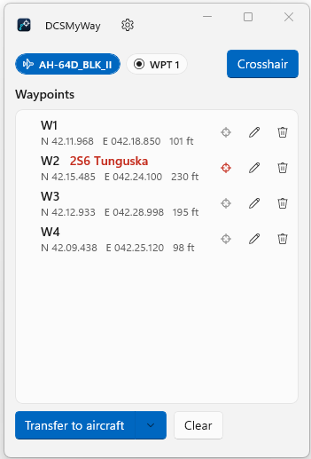
  &nbsp;
  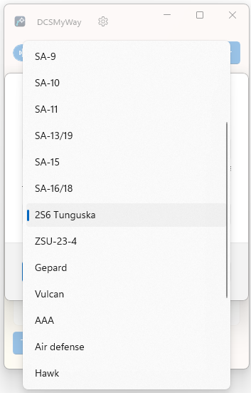
</p>

<p align="center">
  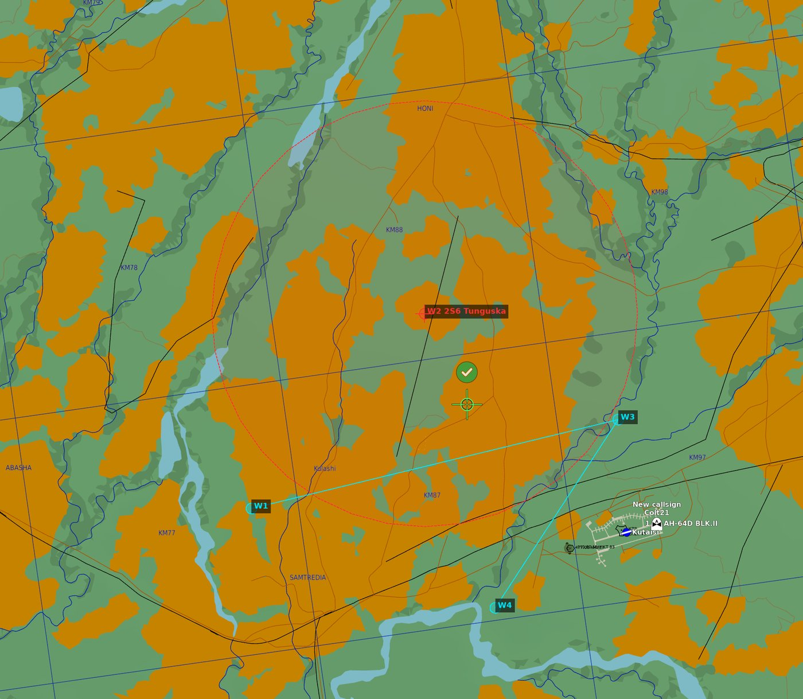
</p>

<p align="center">
  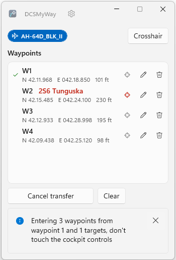
  &nbsp;
  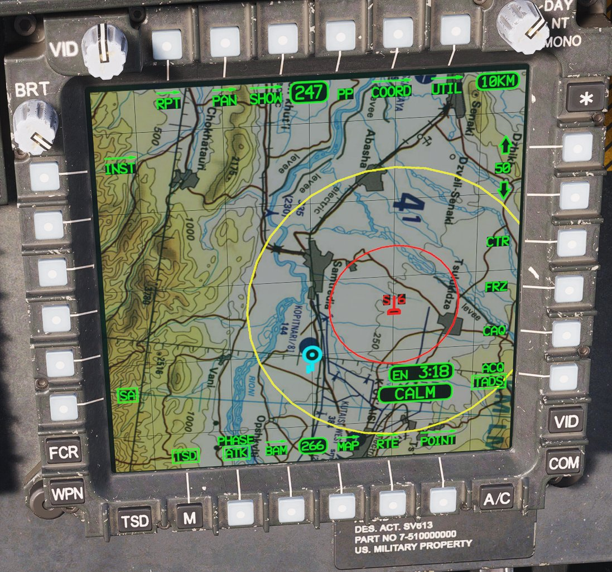
</p>

### Ka-50: waypoints and NAV targets

The Ka-50 works the same way: turn on the crosshair button of a point to enter it as a NAV target instead of a waypoint. Targets continue after the last one you sent. The ABRIS keeps its own routes and is never touched.

### Keyboard shortcuts

Open **Settings** (the gear next to the title) and click the button next to an action to set its shortcut. Press the keys you want, with Ctrl, Shift or Alt if you like, and click **Save**. **Clear** removes it.

| Action | What it does |
|---|---|
| Show/hide crosshair | Same as the Crosshair button |
| Add waypoint | Adds a waypoint under the crosshair (the crosshair must be showing) |
| Delete last waypoint | Removes the last waypoint, handy when you misplace one |
| Transfer or cancel | Starts a transfer, or cancels the one that's running |
| Clear all | Empties the list |

- **No defaults.** Nothing is assigned until you choose, so nothing clashes with your DCS bindings.
- **Global.** Shortcuts work while DCS is in front, and DCS doesn't receive the keys you assign.
- **Joysticks too.** Buttons mapped to keys with Joystick Gremlin, SimAppPro and similar tools work too.
- **Feedback in DCS.** Each shortcut shows a short message on the DCS screen ("W3 deleted", "Waypoints cleared", …), even with the crosshair hidden.

### Settings

<p align="center">
  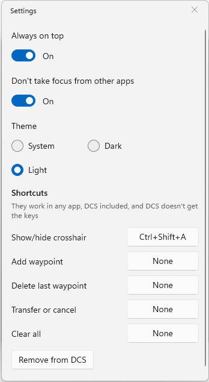
</p>

| Setting | What it does |
|---|---|
| Always on top | Keeps DCSMyWay above DCS |
| Don't take focus from other apps | Clicking DCSMyWay doesn't take the keyboard away from DCS |
| Theme | System, light or dark |
| Shortcuts | See [Keyboard shortcuts](#keyboard-shortcuts) |
| Remove from DCS | See [Uninstall](#uninstall) |

## Aircraft notes

Before a transfer, put the display DCSMyWay reads on the right page. The app tells you if it can't read the active steerpoint:

| Aircraft | What DCSMyWay needs | Good to know |
|---|---|---|
| F-16C | The DED on its main page | It gets back to the main DED page by itself (RTN) from any page |
| F/A-18C | The HSI on one of the displays | It sets the HSI DATA page to decimal minutes and PRECISE by itself. Waypoint 0 (usually your airfield) is never used |
| A-10C | The CDU turned on | Waypoints are created when they don't exist yet and added to the active flight plan. Names are entered too |
| AH-64D | The TSD in NAV phase on one of your MPDs | Waypoints share W01–W50 with hazards. Targets get the next free T## |
| Ka-50 | The PVI-800 on OPER with a waypoint selected (WPT) | No elevation is stored. It ends back on OPER with the waypoint you had |
| Mirage F1EE | The INS turned on (the CE and BE have no INS) | No elevation is stored. It never touches the INS modes selector |

## Troubleshooting

**The aircraft chip never appears.**
DCSMyWay needs its scripts in DCS. Check the message at the bottom of the window when it starts. If it installed or updated them, restart DCS. If another program uses port 42080, the window tells you.

**"The DCSMyWay export script is not running".**
Restart the mission so DCS loads the export script. In multiplayer, some servers turn off player exports. Without them DCSMyWay can't read or press cockpit controls.

**The route doesn't show on the F10 map.**
Map drawing works in single player and when you host. As a multiplayer client the mission runs on the server, so there's nothing to draw on. DCSMyWay also adds two entries to `Saved Games\DCS\Config\autoexec.cfg` that the map drawing needs. If you edited that file yourself, check that `"userhooks"` is in `net.allow_unsafe_api` and `"mission"` in `net.allow_dostring_in`.

**A transfer stopped with a message.**
Something in the cockpit didn't respond as expected: a page that didn't open, or a value that didn't read back. The waypoints with a checkmark are in. Fix what the message says and transfer again: only the rest are sent.

**VR.**
Not tested in VR yet. The cockpit transfer, the shortcuts and the F10 route don't depend on the screen. To see the DCSMyWay window inside the headset you need a desktop overlay tool such as OpenKneeboard.

## Uninstall

1. In DCSMyWay open **Settings** and click **Remove from DCS**. It deletes its scripts from `Saved Games` and only the lines it added to `Export.lua` and `autoexec.cfg`, then closes.
2. Delete `DCSMyWay.exe`.
3. Optionally delete `%LocalAppData%\DCSMyWay` (your settings) and `%TEMP%\.net\DCSMyWay` (the unpacked app).

## Building from source

You need the [.NET 10 SDK](https://dotnet.microsoft.com/download). No Visual Studio is required.

```bash
dotnet build src/DCSMyWay
dotnet test
dotnet publish src/DCSMyWay -c Release
```

The published app is `dist/DCSMyWay.exe`.

## Credits

- [DCS TheWay](https://github.com/aronCiucu/DCSTheWay) by [aronCiucu](https://github.com/aronCiucu) and contributors, the inspiration for this project and the source of its aircraft button sequences.
- Eagle Dynamics and the module developers for DCS World.
